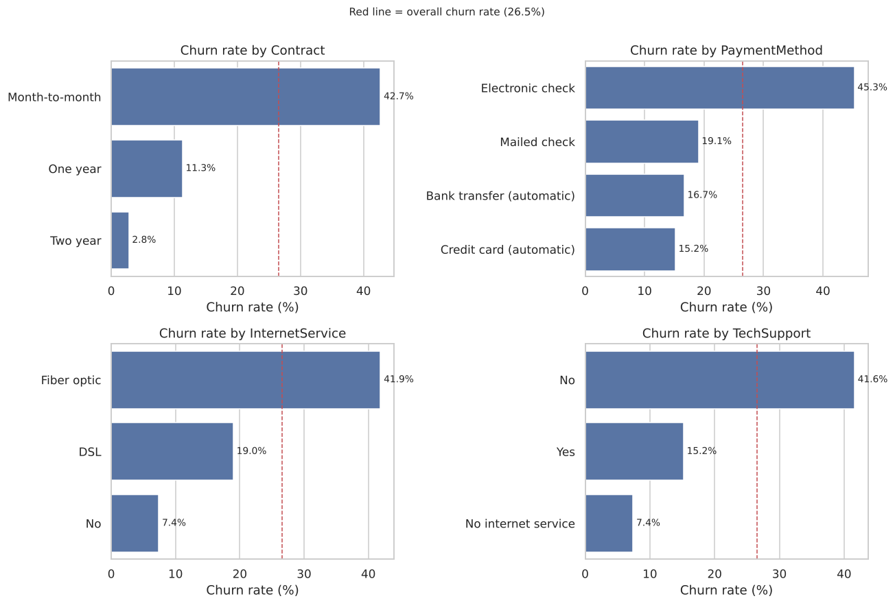
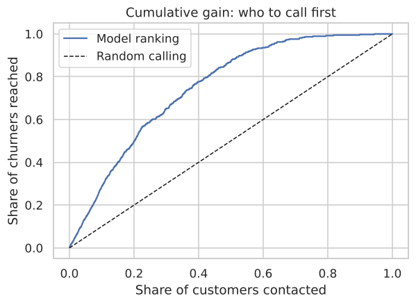

# Customer Churn Prediction (Telco)

**Which customers are about to cancel, and who should the retention team call first?**

A churn model that ranks 7,043 telco customers by risk and explains why they leave. If the team calls only the **riskiest 20% of customers, it reaches 50% of all churners**, 2.5× better than calling at random.



## Key findings

| Driver | Churn rate |
| --- | --- |
| Month-to-month contract | **42.7%** (vs 2.8% on two-year contracts) |
| First 6 months as a customer | **52.9%** (vs 9.5% after 4 years) |
| Pays by electronic check | **45.3%** (vs 15–17% on autopay) |
| Fiber optic internet | **41.9%** (vs 19.0% on DSL) |
| No tech support | **41.6%** (vs 15.2% with support) |

Overall churn rate: **26.5%**.

## Model

Five models were compared with 5-fold stratified cross-validation. Imbalance was handled with class weighting, which raised recall from about 54% to 80% of churners with almost no change in ROC-AUC.

| Model (cross-validation) | ROC-AUC | Recall | Precision |
| --- | --- | --- | --- |
| Gradient Boosting | 0.848 | 0.529 | 0.662 |
| Logistic Regression | 0.846 | 0.544 | 0.653 |
| **Logistic Regression (balanced)** ✔ | **0.846** | **0.801** | 0.517 |
| Random Forest (balanced) | 0.844 | 0.764 | 0.536 |
| Random Forest | 0.844 | 0.504 | 0.668 |

**Chosen model on the held-out test set:** ROC-AUC 0.842, recall 0.783, precision 0.505.
It catches about 8 in 10 churners, and its coefficients are easy to explain to non-technical teams.



## Recommendations

1. **Move month-to-month customers to 1-year plans** with a targeted discount for the highest-risk group.
2. **Run a 90-day onboarding programme**, because more than half of churn happens in the first six months.
3. **Nudge electronic-check payers to autopay** with a small incentive.
4. **Bundle tech support and online security for fiber customers.**
5. **Score customers monthly and call from the top of the list.**

## Project structure

```
├── churn_prediction.ipynb   # full analysis: cleaning, EDA, models, evaluation, recommendations
├── build_notebook.py        # script that rebuilds and re-executes the notebook
├── nbrun.py                 # small helper that executes cells and stores outputs
├── data/telco_customer_churn.csv
└── images/                  # charts used in this README
```

**Run it:** `pip install pandas numpy scikit-learn matplotlib seaborn`, then open `churn_prediction.ipynb`.

## Context

Rebuilt and completed from my *Conqueror Project 1* in the Digital Skola Data Science Bootcamp (2026).
Data: IBM Telco Customer Churn sample dataset (public).

---
Muhammad Irsyad Dzulfaqor · [LinkedIn](https://www.linkedin.com/in/mirsyaddzulfaqor/) · [GitHub](https://github.com/mirsyaddzulfaqor-tech)
